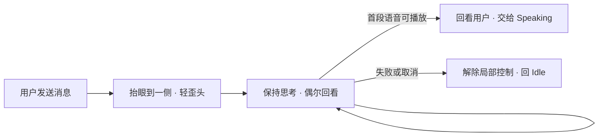

# CH0069_home Companion 表现设计

> 历史讨论稿：2026-10-08 用户已将目标改为通过 unity-spine 实现应用内运动与交互，停止 `.spine` 制作路线。当前设计请以 [运行时行为设计](CH0069_Companion_运行时行为设计.md) 为准。下文保留原讨论记录，其工程路线和未验证假设不再作为当前实施指令。

版本：历史讨论稿 v0.2。日期：2026-10-08（Asia/Shanghai）。原讨论覆盖 Thinking、八种情绪和动作白名单。

## 已对齐的方向

用户已选择：Thinking 使用可辨识的抬眼、轻歪头；先看向一侧思考，偶尔回看用户，准备回答时重新看向用户；日常情绪克制，惊讶和害羞等更明显；动作白名单以资源为先，只开放经验证的原作动作，缺项先回退。

以 CH0069_home 卧室夜景、躺卧托腮姿态为基准。保留原作构图、背景动态、头发和翅膀；不设计站起、挥手等会破坏支撑姿态的动作。Thinking 是应用状态的表现，情绪是独立的持续表情，动作是一次短暂行为，三者分别管理。

## 证据边界

已验证：CH0069_home 在 Test / Unity 6000.3.7f1 / spine-unity 4.2.120 中，Idle_01 自动播放约 118 秒、完成 3 次循环；骨骼和图集完整。GiftCompanion / Unity 6000.6.4f1 尚未完成该验证。依据见 [资源审查](../Audits/Spine/MemoryLobby/模型适用性审查.md) 和 [Unity 播放记录](../Audits/Spine/MemoryLobby/UnityPlayback/最小播放验证.md)；设计以根目录 [项目总宪法](../../项目总宪法.md) 第 10～14、45、47、49～51 节为约束。

资源列表包含 Talk、Pat/PatEnd、Look/LookEnd，没有显式 Think 动画和已核验的八种情绪映射。Talk_01_A 只有附件切换时间线，Talk_01_M 包含骨骼变换和原作 Event；不能按 A/M 后缀推定性别或直接作为通用 TTS 动画。CH0069 的 Pat_01_A、Pat_01_M、Look_01_M 是零时长姿态片段，应按姿态保持验证。

目前只有 Idle 的 Unity 播放经过完整验证。本文涉及的眼睛、眉毛、嘴角控制均为制作目标，尚未确认具体可控骨骼、附件或变形范围；不得视为现成能力。确切控制名称在后续面部盘点中填入。

## Thinking 方案

### 观感目标

用户发送消息后，约 0.2～0.4 秒内能看出角色开始思考。抬眼是主要信号，轻歪头是辅助信号。动作由“进入、等待循环、退出”构成，等待长短不影响循环完整性。无需等待 LLM 返回 META 才启动 Thinking。

已对齐的视线节奏：先看向稍上方的一侧，偶尔回看用户，准备回答时重新看向用户。初版固定一侧，不随机来回扫视；左右方向以现有眼部控制与托腮构图试做后决定。先做 Neutral Thinking，再用 happy/concern 的表情叠加形成变体。

| 段落 | 初始设计时长 | 行为 |
|---|---|---|
| 进入 | 0.35～0.6 秒 | 当前姿态平滑过渡到抬眼，嘴部收为自然闭合；轻歪头开始 |
| 等待循环 | 6～8 秒 | 视线保持 1～2 秒，缓慢回落或回看；轻歪头只在循环中发生一次；保留自然眨眼与原有呼吸 |
| 长等待变化 | 每 2～3 次循环可变化 | 改变视线停留时间或略减歪头，避免机械重复；不增加不耐烦或焦虑含义 |
| 退出 | 0.2～0.35 秒 | 停止抬眼，重新对向用户；平滑交给 Speaking 或 Idle |

一个初始循环节奏可设为：侧上方停留约 2 秒，慢慢回看约 0.4 秒，回看保持约 0.7 秒，再回到侧上方；剩余时间由自然眨眼和静止停留组成。每个循环最多一次明显的歪头，避免持续摇摆。准备回答时的回看从循环中任意位置开始，不强制先回到首帧。

数字是调动画的起点，不是实测参数或固定验收门槛。头部旋转初始目标为相对原姿态约 2～4°，试做时优先保持手掌与脸的接触，必要时降低头部幅度并增强视线信号。屏幕方向和骨骼局部轴尚需实测，不能把全局坐标旋转直接加到头骨上。

Neutral Thinking 是通用头部与视线循环。Happy Thinking 使用同一循环加较轻快的眉眼；Concern Thinking 使用同一循环加轻收眉眼。V1 不制作三套重复身体动画；happy/concern 的独立控制不可用时，明确回退 Neutral Thinking。其余情绪用标准循环配对应情绪姿态，避免八套 Thinking 动画。

### 触发与退出

- Send 后立即进入 Thinking，使用当前短期情绪；收到 META 后可平滑调整 happy/concern 等表情。
- 等待 LLM、等待第一段可播放语音都保持 Thinking。META 或文本出现本身不触发 Speaking。
- 第一段 Audio Ready 后，停止 Thinking 的局部控制并进入 Speaking；不等完整循环播完。
- TTS 不可用时，在文字回复实际开始呈现时退出 Thinking，显示字幕并保留闭嘴的情绪姿态；不假装有语音在播放。
- 请求失败或取消后退出 Thinking，回 Idle。不得无限留在等待状态；取消沿用项目的 CancellationToken。
- 旧请求迟到的 META、Audio Ready 或动画结束回调不能恢复旧状态；所有异步反馈校验当前 turnId 和取消状态。语音段间的短空隙保持 Speaking 状态、暂时闭嘴，不在每个空隙重新进入 Thinking。
- Thinking 期间触摸可作短暂局部反馈，反馈结束恢复 Thinking，不改变正在等待的对话状态；不直接阻塞或取消 LLM。

### 实现路线的选择

若有可编辑 .spine 工程，优先制作少量“仅角色局部属性”的进入/循环/退出片段，继续用 Idle_01 保持背景和基础动态。拟议片段名例如 Think_Neutral_Loop，仅是设计命名，未制作前不得写入正式动作清单。

若只有 .skel/atlas/PNG，先做运行时局部控制原型：每帧在动画应用后，从该帧原始姿态计算视线和头部偏移，避免逐帧累积旋转；结束时解除偏移。须先确认眼睛/头部受哪些 IK 和 Transform 约束影响，选择合适的更新阶段，验证支撑接触、遮挡和网格连续性。不要编辑二进制字节或在业务代码里写骨骼名称。

运行时原型仍是通过角色动画表现 Thinking，但正式技术路线要在原型可视效果和维护成本检查后决定。若现有眼部无可用控制，也没有合适附件，应登记美术缺口；不能用整体眼部贴图平移硬凑表情。

“只开放原作动作”约束 LLM action 白名单。Thinking 与八种情绪属于本地状态表现；它们的局部控制不作为新的 LLM action 开放。未确认编辑源工程前，采用现有骨架与附件的局部控制作为设计假设，暂不承诺可实现的具体动作幅度。

## 八种情绪

下面描述的是画面意图。每种情绪分为“进入、保持、退出”，保持时不周期性重复入场动作。说话时优先让嘴部服务发声，眉眼保留情绪；眨眼与口型只由一个控制器写入。

| Emotion | 画面目标 | 幅度与持续方式 | Thinking 的适配 | 暂不可制作时的回退 |
|---|---|---|---|---|
| neutral | 自然眼神、原作放松嘴角 | 最克制；原 Idle 基础表情 | 抬眼、轻歪头的标准版 | Idle 基础姿态 |
| happy | 眼神明亮，眉眼放松，嘴角轻扬 | 日常克制；不持续大笑或闭眼 | 保留较轻快的抬眼，不反复点头 | neutral |
| shy | 视线短暂移开，嘴角略收，小幅回看 | 比 happy 更明显；身体姿态仍克制 | 侧向视线与一次回看；减少头部叠加 | neutral；不得自动解释成 happy |
| concern | 眉眼轻收，专注看向用户，嘴角自然收敛 | 克制且温和，避免愤怒脸 | concern 表情配标准 Thinking | neutral |
| sad | 视线稍低，眼睑略放松，嘴角弱化 | 中等可辨；不加入眼泪或持续抽泣 | 以低视线起点进入思考，不额外加大歪头 | neutral；不得自动解释成 concern |
| surprised | 眼睛短暂睁大，眉毛稍抬；闭嘴时可有小幅张口 | 入场明显 0.4～0.8 秒，随后收敛为惊讶保持脸 | 短入场结束后接标准 Thinking，避免长期瞪眼 | neutral |
| annoyed | 眉眼略收，短暂侧视，嘴角收紧 | 中等幅度，偏轻微不满；不做威胁或夸张怒斥 | 思考仍可见，但不添加摔头、攻击姿态 | neutral；不得偷偷改成 concern |
| sleepy | 上眼睑略低，眨眼较慢，嘴角放松 | 可辨但不过度；首版不做打哈欠或睡着 | 头部幅度稍小，保持清醒的回复姿态 | neutral |

害羞的红晕仅在确认已有可用附件、颜色控制或可编辑美术后加入；不能据原画已有红晕承诺其可动态增强。惊讶的张嘴不能与 Speaking 口型竞争。sad、sleepy 和 annoyed 的相似眼睑变化，应依靠视线与眉形区分，不能只统一“半闭眼”。

设计验收：在最终大厅构图而非脸部放大图上，至少能辨认日常与明显情绪的差异；弱表情仍以台词语义为主。不要求任何情绪都必须有新的身体动作。连续切换情绪时不留下旧的附件、骨骼偏移或闭眼状态。

## 动作白名单

白名单由真实资源和验收状态驱动。业务接口使用语义 ID，Spine 名称只保存在 Manifest。State 切换不经 LLM action 请求执行；情绪也不等于动作。

### 现阶段可启用范围

**LLM action 目前只允许 none。** none 是协议约定的“不额外播放动作”，不是名为 none 的 Spine 动画。Idle_01 作为内部基础状态使用，不需要开放成“用户动作”。这符合用户的“只开放经验证的原作动作”选择；候选需完成新一轮可视与结束行为验收后再加入。

缺失或未知的 action 按协议归为 none，基础状态继续按当前对话状态运行。Idle 是内部缺项保护的最终安全回退，但未知 action 不能把正在 Thinking/Speaking 的角色强制切回 Idle。回退不得中断音频或对话。

### 原作动作候选

| 语义 ID（拟议） | 原作候选 | 触发权限 | 启用前必须验证 |
|---|---|---|---|
| look_at_user | Look_01_M + LookEnd_01_A / LookEnd_01_M | 可作为首个 LLM action 候选 | 是否确实改变注视方向、零时长姿态如何保持、A/M 的组合与恢复、能否兼容当前情绪 |
| headpat_reaction | Pat_01_A / Pat_01_M + PatEnd_01_A / PatEnd_01_M | 本地真实触摸事件；不开放给 LLM | 手部支撑、脸部变化、按下/保持/释放、当前状态恢复、快速重复触摸 |
| entrance | Start_Idle_01 | 场景控制器；不开放给 LLM | 入场构图、时长约 20 秒是否适合用户体验、事件与可打断性；首版可直接 Idle |
| speaking_original_candidate | Talk_01～05 的 A/M/CN 片段 | 内部 Speaking 研究候选；不作为 LLM action | 嘴部/表情与身体时间线拆分、Event 过滤、任意语音长度、接回 Idle；未通过前不启用 |

上面的语义名称与视觉用途均未作为正式配置。Look 不能只凭名字宣称“看向用户”；若实际语义不符，该候选从白名单删除或重新命名。Pat 必须来自真实触摸，不能让模型自己触发“被用户摸头”。

首版不规划 greet、nod、shake_head、comfort、laugh 等新动作。Dev_*、Dummy、裸动画名、任意骨骼名、任意裁剪时间不进入 LLM 白名单。Thinking 是本地状态动画，也不向 LLM 开放为可延长等待的 action。

### 仲裁规则

- 实时对话状态由控制器决定；action 只能占用其已验证的局部属性。
- 不同时间线不能自动按 track 序号保证互不干扰；先盘点写入的骨骼、插槽、附件和约束，再决定分轨或合成方式。
- 同一属性只能有一个当前写入者：基础 Idle、Thinking、情绪、口型与触摸之间明确交接。原作对白的 A 附件切换不能直接叠在情绪附件上。
- 每帧先读取基础动画姿态，按当前状态合成一个最终面部目标，再由一个表现控制器统一写入。固定优先顺序：真实触摸的短暂反馈 → 状态所需视线与口型 → 情绪目标 → 基础 Idle；这只是重叠属性的仲裁规则，不表示触摸可以抢占音频或 LLM 生命周期。Speaking 时 mouth 属性始终由语音表现拥有，shy 等情绪只影响嘴角之外的已验证属性或眉眼。
- Thinking/Speaking 期间，LLM 的可选动作若会覆盖眼睛、头部或口型，则本次 action 归为 none；首版不建立复杂延迟动作队列。
- 触摸反馈可短暂覆盖面部情绪，释放后恢复当前情绪与实际对话状态。Thinking 结束、音频开始和用户打断能立即取消不兼容的局部动作。
- 验收通过的动作设置一次性执行、最大保持时间和重复触发间隔。初始候选为：注视约 0.6～1.2 秒保持，最长约 2 秒，重复间隔约 3 秒；触摸保持跟随真实按压，长按需有超时释放与失焦释放。数字均待模型验证后确认。

退出局部动画不能只调用 ClearTrack 后假定姿态自动复原；需平滑混出，并按当帧基础姿态与当前情绪恢复被覆盖属性。不要对整个骨架调用 setup reset 作为每次退出方案，防止背景、头发和附件闪回。Spine 的分轨只对各动画实际写入的属性分层，且清空轨道本身可能留下当前姿态。[官方动画应用说明](https://esotericsoftware.com/spine-applying-animations)

运行时局部控制可优先评估 4.2 的 UpdateLocal（动画应用后、世界变换前）；若依赖世界坐标或受约束覆盖，则另评估 UpdateWorld 的额外变换成本。最终阶段选择需以该模型的约束关系验证，不能在多个回调同时重复偏移。[官方 spine-unity 4.2 生命周期](https://esotericsoftware.com/spine-unity-main-components-4.2#Life-cycle)

### 拟议配置记录

保持现有 character_manifest / expression_map 的职责，确切字段以后按工程实现确认。讨论阶段不创建新的运行时 JSON。每个拟启用映射至少记录：语义 ID、真实动画或局部控制配方、允许来源、可用状态、保持/退出方式、占用属性、缺项回退和验收证据。

例如 look_at_user 当前应记录为“候选、enabled=false、来源=LLM、真实资源=Look 系列待确认、仅在兼容状态执行、fallback=none”。Thinking 的配方记录为“本地状态、不对 LLM 开放、来源工程与控制属性待确认”；八种情绪的映射逐项保留 pending 状态和 neutral 回退，不能先填写虚构 Face_Happy 等资源名。

## 设计验收清单

| 场景 | 验收目标 |
|---|---|
| 0.5 秒以内开始思考 | 可看出视线或头部进入动作；不要求完整进场播完 |
| 首段语音很快到达 | 从任意 Thinking 阶段平滑退出，首段音频不被动画阻塞 |
| 长等待 30～60 秒 | 不冻结、不夸张摆头、不反复出现惊讶等入场表情 |
| 八种情绪保持 | 日常表情克制，shy/surprised 明显；眉眼与 mouth 不争夺控制 |
| Thought + Emotion | 状态循环保持可读，happy/concern 缺项可明确回退 Neutral Thinking |
| Speaking 期间摸头 | 音频与口型持续，局部反馈退出后恢复最新情绪；不回到旧的 Thinking |
| 情绪连续切换 | 无残留闭眼、错误附件或头部累计偏移 |
| 不存在的 action | 归为 none，当前 Thinking/Speaking 继续，不抛异常 |
| 连续发送与取消 | 旧回调不再写入新一轮状态或表情 |
| 支撑姿态与背景 | 手掌与脸无明显分离或穿插，背景/翅膀/头发原有动态持续 |

## 制作与评审顺序

1. 只读盘点脸部、眼睛、眉毛、嘴部、头部、手部的附件和时间线，标明每种候选的写入属性。先验证 Look/Pat 的实际语义，不假设动画后缀含义。
2. 制作一段 Neutral Thinking 进入/循环/退出原型，与 Idle 做同构图对照；短等待、30～60 秒等待和任意时刻退出都要看。
3. 先出 neutral/happy/concern 三种情绪静态样，再出 shy/surprised 的明显变化，最后区分 sad/annoyed/sleepy。每种提供闭嘴保持和 Speaking 下的眉眼保持方案。
4. 逐个评审原作动作候选，通过后才添加语义 ID 和完整的开始、保持、退出、回退配置。公开给 LLM 的列表必须由启用项生成。
5. 最后验证 Thinking→Speaking、Thinking+Concern、Speaking+Shy、触摸覆盖后恢复、未知 action 和连续取消。仍需在 GiftCompanion 固定版本复测。

产出应为少量动作或局部控制配方、八种情绪映射及一张小白名单；保持单一 ICompanionVisualController，不新增动画框架或改变 CharacterCore 的职责。

## 仍需对齐

1. 是否另外持有可编辑 .spine 工程？尚未收到答复，当前不承诺源工程制作路线，先按现有资源设计。
2. 抬眼/歪头幅度、侧视的具体方向和八种情绪的脸部样式，留到第一组同构图原型评审时对齐。

视线节奏已确认。本轮本地命令执行环境报 setup refresh 错误、Unity MCP 新请求返回 HTTP 502，因此没有补做面部属性盘点；本文基于此前保存的实测证据与本轮用户选择，不把拟议控制目标当作新实测结果。文档保存通过文件编辑工具完成。
