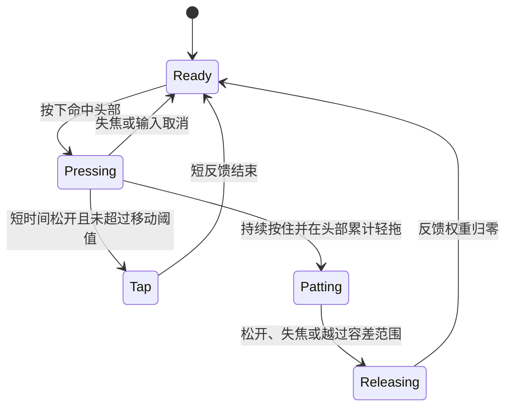
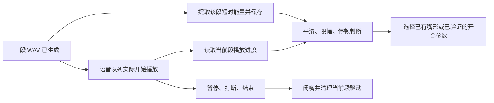
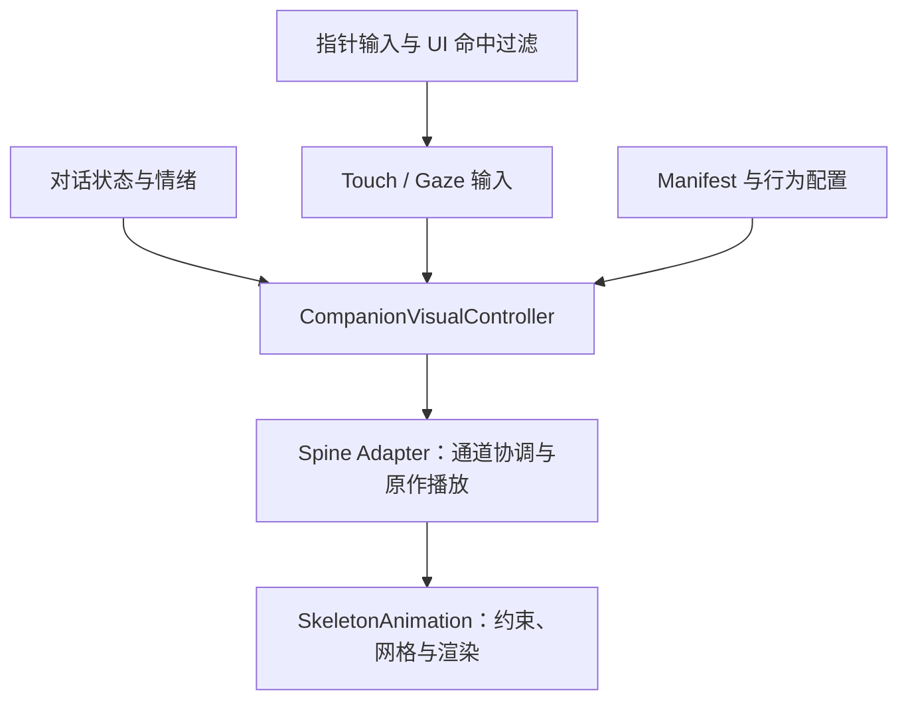

# CH0069_home Companion 运行时行为设计

版本：设计基准 v0.5。日期：2026-10-09（Asia/Shanghai）。阶段：原作动作拓展与组合；MemoryLobby 独立验证原型已建立，最新实施结果见 [运行时反馈优化 v0.2](../Audits/Spine/MemoryLobby/RuntimeBehavior/运行时反馈优化_v0.2.md)，历史结果见 [首版运行时行为验证](../Audits/Spine/MemoryLobby/RuntimeBehavior/首版运行时行为验证.md)。正式应用接入单独验收。

## 1. 当前目标与已对齐选择

通过 Unity 中的 spine-unity，让角色在应用中持续运动、关注用户输入、接受摸头，并同时表现互相兼容的局部行为。交付对象是可运行的角色控制与配置，制作流程全部在 Unity 中进行。现有 `.skel`、atlas 和 PNG 是运行时输入，保留原件；不再以新建 `.spine`、重建骨架或导出新增动画文件为目标。

已确认：

- 摸头使用“按住并在头部轻拖动”；单击头部只作短反馈。
- 摸头准备多组表情设置，每次有效触摸随机选择一组，持续手势期间保持该组。
- 说话增加由实际语音播放驱动的口型；Thinking 增加克制的动态眉眼与表情变化。
- Thinking 保留可辨识的抬眼、轻歪头，以及“先侧看、偶尔回看、准备回答时重新看向用户”的意图，改为运行时行为。
- 日常情绪克制，惊讶、害羞等相对明显；资源缺项明确回退。
- LLM 动作白名单继续以资源为先，只开放验证通过的原作动作。

已确认的待机调整：常驻时只增加眼球张望，不增加头部跟随或偏转；保留原作 Idle 自身的呼吸与场景动态。鼠标移动时眼睛关注它，静止约 2.2 秒后恢复缓慢张望。Thinking 与摸头保留各自的小幅头部反馈。

用户举出的“挥手时叠加局部动作”作为组合能力的验收例子。CH0069_home 当前未确认有可用挥手资源，且是躺卧托腮构图。首版用已有动作验证组合规则；只有模型实际支持、手脸支撑与遮挡通过检查后才启用挥手，不能将其他动作冒充挥手。

### 1.1 制作重点与原作质量标准

制作中心是**已有动作的拓展、局部复用、表情变体和兼容组合**，让待机与交互更自然。spine-unity 运行时适合播放、混合和受控微调；本项目当前不采用它重建复杂、精细的全新关键帧动画。Unity 中主要制作参数、行为时序、控制权和资源映射。

优先顺序：原作动作/姿态原样复用 → 验证后的局部时间线与现成附件组合 → 少量平滑、限幅的程序化偏移。首版聚焦自然待机、摸头多表情、语音口型和 Thinking 表情动态；大幅转身、站起、复杂手势和新绘制表情不在本轮范围。某项必须大改网格、约束或画面才能成立时，将其登记为资源缺项并回退。

“保证原始游戏质量”作为启用门槛：在相同相机、缩放、光色和原件 Idle 的对照下，原作线条、贴图、眼嘴形状、手脸接触、头发与身体连接、前后遮挡、背景动态均保持稳定；新增运动起止连贯，没有闪切、穿帮、拉伸、贴图滑动或残留。由原作素材构成也不自动等于达到原作质量，必须逐项可视验收；宁可减少幅度与变体数量，也不以效果数量替代质量。

## 2. 项目标准与实施边界

依据 [项目总宪法](../../项目总宪法.md) 第 6、10～14、45、47、49～51 节：角色逻辑留在 CharacterCore，视觉由 Companion Adapter 管理；状态与情绪独立；资源名称由 Manifest 映射；触摸不阻塞对话；主画面保持记忆大厅观感；先验证最小链路。

本设计将“Thinking 动画”落实为可见的运行时角色运动，继续由 Send 和首段 Audio Ready 驱动。Neutral/Happy/Concern 是行为与表情的组合，表情控制未验证时统一回退 Neutral。

手册第 47 节的 Touched → Idle 用于基础 Idle 的触摸流程。对于触摸期间仍在进行的 Thinking/Speaking，Touched 作为短暂视觉反应，结束后依据**当前**对话状态重算表现。不得把对话强制改成 Idle，也不得恢复开始触摸时缓存的旧状态。这是当前“兼容局部反应”的具体化规则。

MemoryLobby 工程用于 Unity 内能力验证；GiftCompanion 是正式应用工程。通过独立验证并满足项目阶段条件后，再接入正式 Companion。Spine 交互不直接复用 AgentPet 的 3D Animator、桌面窗口拖动或工具执行能力。

## 3. 已知事实与能力缺口

| 内容 | 当前证据 | 对设计的影响 |
|---|---|---|
| 原始 CH0069_home | Spine 数据 4.2.33；743 根骨骼、294 个插槽、52 个动画 | 保留完整原作场景和基础动态 |
| Idle_01 | 已在 Test 工程完成约 118 秒、3 次循环的播放验证 | 首版基础表现候选；新工程仍需重新确认渲染 |
| 当前工具 | MemoryLobby / Unity 6000.3.7f1 / spine-csharp 包声明 4.2.37；MCP 可用 | 使用本地运行库 API，不依赖独立 Spine 编辑器 |
| 注视目标 | `Touch_Eye_Key`，父级 `Touch_Eye`；原有眼部约束以它为目标 | 优先控制原作目标骨骼，先校准可见方向与幅度 |
| 眼部联动 | 部分眼部约束平移 mix 约 0.12/0.06；另有该目标到 `Touch_Point_Key` 的 0.25 平移联动 | 改视线可能影响眉眼、脸部等，不能视为纯瞳孔控制 |
| 头部 | `Head_Rot` 的父级为 `Face` | 仅是可读写候选；转头幅度与支撑接触尚未验收 |
| 托腮 | `Face_con` 以 `Face` 为目标，联动 `L_ForeArm_01_pos` | 头、脸、前臂存在耦合，避免大幅转动 |
| Pat / Look | 有原作候选；`Pat_01_A`、`Pat_01_M`、`Look_01_M` 为零时长姿态 | 不能用普通完成事件判断结束；需明确保持与退场 |
| 原作对白 | `Talk_01_A` 仅有附件时间线；`Talk_01_M` 含身体变换和原作 Event | 先定位真实嘴部属性，不直接循环完整对白片段适配任意 TTS |
| 多组摸头表情、口型、Thinking 动态、八种情绪、挥手及局部组合 | 尚无完整可视验收 | 先记为能力待验证，不写入启用白名单 |

本节是设计盘点时的能力快照；当前实测状态见实施报告。以上骨骼与约束信息来自上一轮对原始二进制的只读盘点；上一轮制作文件已删除。眼睛、头部“有可控节点”不等于“已完成可用交互”。此前生成 JSON 的解析与数值比对不作为新交互的验收依据。

历史证据见 [模型审查](../Audits/Spine/MemoryLobby/模型适用性审查.md)、[Idle 播放验证](../Audits/Spine/MemoryLobby/UnityPlayback/最小播放验证.md)。

## 4. 角色应如何表现

| 场景 | 用户看到的行为 | 结束或被打断时 |
|---|---|---|
| 无输入待机 | 原作呼吸、头发、背景持续；眼球缓慢四处张望，无新增头部偏转 | 新输入平滑取得对应部位的控制 |
| 鼠标进入可关注区域 | 眼睛看向移动的鼠标，静止约 2.2 秒后恢复张望 | 离开、失焦或打开菜单后回到当前基础状态 |
| 单击头部 | 短暂表情与原作 Pat 头部反馈 | 不进入持续摸头，结束后恢复当前状态 |
| 按住头部并轻拖 | 随机选择一组经过验证的摸头表情，以现有 Pat/眉眼作持续局部反馈 | 松开、离开允许范围或失焦后退场 |
| 等待回复 | 侧向抬眼、偶尔回看，一次轻歪头，配小幅眉眼变化；保留背景动态 | 首段可播放语音到达即开始回看，不等待周期结束 |
| 正在说话 | 嘴部随实际语音开合，停顿闭嘴；保留兼容的眉眼与身体动作 | 段间短空隙暂时闭嘴，维持 Speaking |
| 原作动作播放 | 动作正常完成，允许兼容的眨眼、视线、嘴部反馈 | 冲突部位暂缓，动作释放后平滑恢复 |
| Menu / MomoTalk | 原作场景仍可待机，停止鼠标关注与触摸捕获 | 关闭界面后从当前业务状态恢复 |

所有运动幅度、时间和停留频率都是调试起点，最终在完整大厅构图中验收；不得仅凭面部放大画面判断可辨识性。

## 5. 输入、命中与摸头

### 5.1 命中区域

首版只启用 Head。Body 作为后续候选，Special 默认关闭。CH0069 使用当前脸部与头部附件网格的三角形判定：`Face`、`Ball_Hair_01`、`F_Hair_01/02`，跟随最终动画和约束姿态；不包含长发、光环或身体。退出边缘使用少量容差。缺少可用网格的其他资源才使用配置椭圆回退；不以 BoundingBox 附件作为前置要求。

鼠标屏幕坐标经渲染相机射线与骨架平面求交，再转为骨架/目标父骨局部坐标。不能用固定屏幕矩形代表头，也不能把像素坐标直接写入骨骼。Canvas、缩放、镜像、宽高比或渲染方式变化后都须重新核验映射。

先由 UI 消费输入。输入框、菜单、MomoTalk、设置页遮挡的点击不再传给角色。指针在模型关注范围内且窗口有焦点时才可驱动关注；不读取桌面其他窗口中的鼠标活动来驱动此模式。

### 5.2 手势判定



起始参数：短点击不超过约 0.25 秒；摸头候选持续约 0.25 秒并累计移动达到头部命中区域宽度的约 4%。阈值随 UI 尺度换算。按住不动暂不触发连续摸头；若之后希望长按也算摸头，只更改手势配置。

按下后捕获该 pointerId。摸头不移动角色位置或应用窗口。边界附近使用小容差，避免判定抖动；越界后执行一次退场，继续按住重新进入不自动重复起手，需新的按下。连续轻拖更新反馈权重，不每帧重播 Pat；快速来回拖动限制峰值与变化速度。单击有短冷却，持续摸头不无限叠加动作队列。

解除捕获统一覆盖：PointerUp、失焦、对象禁用、骨架重建、场景/模式切换、UI 接管输入。入口与退场幂等，重复调用也能回到干净状态。

### 5.3 反馈资源

当前验证原型复用零时长 `Pat_01_M` 的脸部转动、眉眼与脸红，约 0.18 秒平滑进入；外部手势决定保持，轻拖方向改变姿态权重并小幅驱动原作触摸目标。`PatEnd_01_M` 以约 0.333 秒原作退场恢复当前基础状态。原作 Pat 相对 Idle 起始姿态约有 2° 的脸部转动，属于姿态反馈而非完整循环摇头动画。Speaking 使用选中表情对应的原作开闭嘴形覆盖 Pat 的嘴部写入，兼容部分继续保留；其他资源组合仍逐项验证。

原作资源不足时，使用已验证的少量注视、轻歪头或眉眼控制作反馈。该反馈是本地行为，不自动增加 LLM action，也不自动将持久情绪改成 happy。

### 5.4 摸头随机表情设置

先盘点现有 Pat、Look、Talk 中可复用的表情附件与姿态，按实际资源组装多组设置。同一原作身体反应可以配不同眉眼，避免为了随机变化另做几套身体动作。下列是画面候选，语义 ID 仅用于设计，不代表资源已经存在或启用：

| 候选设置 | 画面意图 | 控制范围与限制 |
|---|---|---|
| `pat_relaxed` 放松 | 眼睑稍放松、缓慢眨眼，头部轻微顺势 | 眼睑、视线、小幅头部；不凭空增加闭眼附件 |
| `pat_pleased` 愉快 | 复用已有自然微笑/舒展眉眼 | 原有眉眼、静态嘴形；说话时嘴部交给口型 |
| `pat_shy` 害羞 | 轻侧视、短暂回看，复用已有害羞表情 | 视线、眉眼；动态红晕不是必备项 |
| `pat_attentive` 轻微意外后关注 | 短暂抬眉或看向触摸处，随后收敛 | 眉眼和注视；不持续瞪眼、不增加明显受惊身体动作 |

首版目标为验证至少 2～3 组明显可区分且符合原作气质的设置；若只验证通过一组，明确记录暂未达到“多组随机”的验收目标，不为了凑数启用未验证表情。实际候选可以根据素材调整。

随机规则：

1. 一次“触摸”是一个有效的按下到松开手势。识别成短点击或首次进入 Patting 时只抽取一次；UI 点击、无效按下和越界不抽取。
2. 从已启用且与当前状态兼容的表情集合中默认等概率抽取，任意一组均可被选中，也允许连续重复。权重或避免重复可以后作为可选配置，首版不暗中改变用户的随机要求。
3. 持续轻拖只调整同一设置的强度与保持时间，不按帧重抽、不按鼠标移动重启。单击使用选中设置的短反馈版本，不播放完整持续摸头。
4. 表情是临时触摸反馈，不覆盖持久 Emotion，不改变关系或记忆；松开后平滑释放，恢复当时实际对话状态与情绪。
5. Speaking 开始时，选中设置中占用 Mouth 的部分释放，兼容眉眼继续；不为此重抽整组表情。原作资源无法分离时，禁用该组合并使用已验证的局部回退。

配置保存设置 ID、真实资源映射、占用通道、进入/保持/退出、短点击版本、兼容状态、启用状态与回退。调试可使用固定随机种子复现一次效果，成品每次触摸只采样一次。

## 6. 待机、注视与局部头部反馈

Idle_01 长期保留为底层。待机变化只在眼球通道附加缓慢连续的目标偏移，使用平滑追随与回归；不每帧随机抖动，不靠重复重启 Idle 制造变化。触摸、Thinking 或原作动作按兼容规则取得对应部位控制，退出后恢复当时实际状态。

鼠标关注的当前节奏：眼睛约 0.2 秒平滑趋向目标；鼠标静止约 2.2 秒后恢复张望，不驱动新增头部跟随。移开后自然回归张望；失焦立即解除输入捕获。该停留参数已保存，真实窗口内的手感仍需体验确认。

CH0069 的原作眼神目标还通过约束联动触摸目标，间接影响头发与脸部。当前抵消新增眼神位移产生的这部分联动，保留原作中立关系，使待机注视只改变眼球。Thinking 约 0.9° 的附加偏转与摸头原作姿态分别处理；不能把平面骨骼旋转当成真正 3D 转脸。

### 6.1 表情和嘴部过渡补充

表情切换在原作短眨眼遮挡下更换虹膜，眼睑覆盖与眉部短淡化；不叠加两组虹膜，以免出现双瞳重影。语音能量经窗口插值与平滑后驱动原作嘴形的连续宽度微调，开闭嘴约 65 毫秒短淡化，尺度限制在源 Talk 已使用的范围内；摸头期间选择相应表情的嘴形。当前是能量驱动的原作嘴形拓展，逐音素口型仍不在本轮交付范围。临时绘制项在过渡结束、禁用和重建时清理，不修改共享骨架数据与原始贴图。

目标位置经局部坐标变换与椭圆范围限制，避免斜角方向超过幅度。眼睛与头部使用不同响应速度。嘴部、眼睑、虹膜的职责分开；闭眼时降低注视偏移，睁眼后平滑恢复。目标骨骼的约束链和最后可见网格一起验收，确保眼睛不越界、眉眼不异常滑动、手掌仍贴合脸部。

## 7. 动作组合与控制权

### 7.1 通道而非全局打断

| 通道 | 内容 | 首版的协调规则 |
|---|---|---|
| Base | 身体基础、背景、头发等原作动态 | Idle 持续；全身动作可按配置接管 |
| Gaze | 注视目标 | 每帧只采用一个来源的目标 |
| Head | 头部姿态偏移 | 托腮限制优先；动作占用时停止额外偏转 |
| Eyelids | 眨眼、闭眼、半闭眼 | 一个写入者；持续闭眼期间暂停原作眨眼控制的冲突部分 |
| Brows | 眉形、眉部强度 | 情绪与触摸由协调器选定最终结果 |
| Mouth | 嘴部附件、变形或开合 | Speaking 优先；触摸与情绪保留不冲突部位 |
| Gesture | 原作一次动作涉及的骨骼和其他属性 | 声明实际占用范围和兼容行为 |

控制权按通道计算。取消/离开模式是生命周期清理，优先于所有表现。说话口型独占 Mouth；动作声明独占的 Head/身体通道受保护。Gaze 默认顺序为触摸反馈 → 回答前回看/Listening/Speaking 关注 → Thinking → 情绪视线偏置 → 鼠标关注 → 自然待机。较低来源可以保留目标，但不能在同一帧抢写。

原作动作若自带眼神或闭眼，并声明占用对应通道，则它在该通道优先；明确允许外部注视时才让鼠标参与。Emotion 独立保存，但视觉通道被占用时可以暂时只显示其兼容部分。

### 7.2 Track 的使用范围

首版建议 Track 0 为基础，Track 1 为已验证的一次原作动作，Track 2 仅在存在实际兼容的表情片段时使用。程序化注视、头部偏移不为每种行为额外建立一个 Track。

Spine 的 Track 不是 Unity AvatarMask，也不会自动把动作限制为上半身。高层动作按真实时间线写入骨骼、插槽、附件、颜色、网格变形、绘制顺序及约束；高层轨道或 Add 混合都不能代替兼容性判断。[官方混合说明](https://esotericsoftware.com/spine-applying-animations)

组合启用前盘点每个动作的属性集合，检查重叠属性，以及父子骨骼和 IK/Transform 约束的间接影响。即使骨骼名称不重叠，也可能因为共同父级或约束发生冲突。首版采用小型配置表和明确允许的组合，不引入通用行为树或大型动作图。

| 示例组合 | 设计结论 |
|---|---|
| Idle + 注视 + 轻微头部跟随 | 首个验证目标；通过限幅与约束检查后启用 |
| Thinking + 摸头 | 摸头短暂接管相关眼/头通道；等待请求继续；结束按当前状态恢复 |
| Speaking + 摸头 | Mouth 归 Speaking；仅启用经过验收的眼/眉/头反馈 |
| 手臂动作 + 眨眼/口型 | 仅在动作不写入相同及间接耦合属性时允许 |
| 假设的挥手 + 注视 | 手臂归动作；视线可保持；若动作占用 Head，缓慢转头暂缓 |
| 两个同时占用 Head 的动作 | 首版不相加；较低行为退让或拒绝新动作，不排无限队列 |

如原作动作夹带全身或背景时间线，首版先按实际范围处理，不能按名称推断“局部”。必要的时间线筛选仅作为后续 Unity 内的只读派生播放方案评估；不修改共享 SkeletonData、不改原始二进制、不重新创作关键帧。附件切换与原作 Event 也必须同时审核。

## 8. 运行库接入与无累积更新

采用 SkeletonAnimation、AnimationState 和现有骨架控制目标。当前 MemoryLobby 本地源码已确认包含 `BeforeApply`、`UpdateLocal`、`UpdateWorld`、`UpdateComplete` 回调；后续实际实现以当前版本代码为准，避免使用 4.3 的不同组件架构。[官方 4.2 组件说明](https://esotericsoftware.com/spine-unity-main-components-4.2)

建议单一 Spine Adapter 管理写入与回调顺序：

1. 输入组件采集指针与手势，只提交语义事件和目标。
2. 行为控制器按当前状态、情绪、动作占用计算最终通道目标和权重。
3. `BeforeApply` 撤销上一帧程序化修改，恢复上次缓存的“程序化修改前”的本地基线。包括骨骼、约束参数及被直接写入的插槽属性；不能只把 Head 角度设为固定初始值。
4. AnimationState 应用原作基础与局部动作。
5. `UpdateLocal` 缓存本帧新基线，只应用协调后的局部偏移一次，随后由运行库求解约束与世界变换。
6. 在最终姿态阶段更新下一次命中检测所需区域；限制检测范围并复用缓存。网格生成和绘制继续由运行库负责。

若实测表明候选目标在约束求解中被覆盖，重新选择目标/更新阶段并验证，避免在多个回调中重复修正同一通道。`UpdateWorld` 会涉及再次求解，不能直接把其中的世界值写回当成本地角度。所有涉及的骨骼引用在初始化或重建时缓存，不每帧查找字符串。

恢复须同时覆盖未被原作动画逐帧键控的属性，防止头部越转越偏、视线偏移累积或表情残留。禁用、取消、骨架重建时先解除本轮修改，再取消订阅、清空引用与权重；重建后只在资源能力校验通过时重新绑定。恢复当前动画姿态，不能每帧整体 SetToSetupPose，避免破坏原作背景和基础动态。

## 9. Thinking、说话口型与对话状态

### 9.1 Thinking 基础行为

Thinking 使用与鼠标关注共用的 Gaze/Head 控制器，不注入名为 Think 的新 Spine 动画。进入约 0.35～0.6 秒；等待行为约 6～8 秒一轮，侧看约 2 秒、回看约 0.4 秒、停留约 0.7 秒、再侧看。时序由行为参数驱动，长等待可轻微变化停留时间，每轮最多一次明显歪头。

准备回答时约 0.2～0.35 秒回看并让出口部表现；无论侧看处于何阶段，都立即响应 Audio Ready，不等循环或触摸完成。取消、失败和新消息均可停止旧 Thinking。没有可见表情能力时沿用 neutral 外观。

### 9.2 Thinking 表情动态

Thinking 的可辨识性由侧向注视、一次轻歪头与眉眼节奏共同承担。优先复用已有自然表情、眨眼附件和眉眼姿态；眉部强度、视线目标或姿态权重缓慢变化。眼睑等离散附件按原作支持的过渡使用，不能假设不同附件之间可连续插值。没有可靠的过渡资源时，保留原作眨眼并减少切换。

| 设置 | 进入与等待 | 回看/退出 |
|---|---|---|
| Neutral Thinking | 自然眉眼，侧看时小幅抬眉或专注；保持原作眨眼 | 回看时眉眼放松，准备回答 |
| Happy Thinking | 已验证的轻微愉快眉眼，侧看与回看稍轻快 | 保留兼容笑意，嘴部交给语音 |
| Concern Thinking | 已验证的轻收眉与专注眼神，偏移幅度克制 | 回看用户时恢复较柔和关注 |

不要求每轮把所有表情变化再播一遍。较长等待只轻微改变注视停留、眨眼间隔或眉部权重，保持当前情绪；不因等待时间增长自动转为烦躁、困倦或焦虑。表情变化与头部动作错开，避免全脸同时机械跳变。原 Idle 已负责的眨眼与呼吸继续使用，只有确认需要接管时才由单一控制器替代。

Thinking 通常保持自然闭嘴，除非原作确有可复用的细微闭嘴变化；不以反复张嘴表达思考。鼠标关注在 Thinking 占用 Gaze 时暂缓。摸头短暂接管对应部位，结束后重新从当前姿态进入 Thinking，而不是从动画首帧突跳。缺少 Happy/Concern 的可靠表情映射时，仍使用 Neutral Thinking 并登记回退。

### 9.3 说话时的口型对应

目标是“有声时自然开合、停顿时闭嘴、开始/结束与实际语音一致”，优先保留原作嘴部画风。先从原作 Talk 的附件/变形/骨骼属性定位真实嘴部通道，确认闭嘴、可用张嘴形态和情绪嘴形之间的关系；不能把 Talk 中所有附件切换都当成口型。

首版采用**语音驱动开合**：用已生成 WAV 的短时能量包络和实际播放进度驱动经过验证的嘴形或开合参数。小、中、大开口仅是资源盘点的类别目标；若原作只有闭嘴/张嘴两档，就使用两档并通过停留、阈值与迟滞减少闪动。不得拉伸嘴部贴图、改动牙齿或硬造缺失口型。

流程：



设计约束：

- 只分析角色当前播放的语音段；BGM、环境声、鼠标声音及原作 Event 不驱动嘴。缓存按音频段标识绑定，不能把下一段能量提前套到当前段。
- 初始分析窗口可用约 20～40 毫秒，结合噪声门、温和归一化、开合阈值迟滞与上升/释放平滑。静音片段不得被归一化成大张嘴；呼吸音、很弱声音不强制明显开口。参数最终按实际角色语音调校。
- 以实际播放位置推进口型，不以请求时间、文本字数、生成进度或独立计时器推进。可采用 `AudioSource.timeSamples` 对齐当前段 PCM 位置；若采用 DSP 调度，则同时记录播放起点和暂停/跳转变化。[Unity 播放位置文档](https://docs.unity3d.com/6000.0/Documentation/ScriptReference/AudioSource-timeSamples.html)、[DSP 时间文档](https://docs.unity3d.com/6000.0/Documentation/ScriptReference/AudioSettings-dspTime.html)
- 能量分析与缓存不等待整条回复完成、不延迟已有的首段播放链路。若某段分析未及时就绪，可用该语音 AudioSource 的输出数据作降级；不采集混合的全局音频。[Unity 输出数据文档](https://docs.unity3d.com/6000.0/Documentation/ScriptReference/AudioSource.GetOutputData.html)
- 尚未播放、语音中的静音停顿、暂停、结束或取消时闭嘴。用户仅降低播放音量但语音仍在播放时，保持口型；显式完全静音时闭嘴并保留 Speaking，解除静音后从当前播放位置接续。应用暂停、显式静音与低音量分别处理，不由输出振幅偶然决定状态。段间闭嘴并保持 Speaking，下一段从自己的播放进度开始。
- 口部由单一控制器写入。Speaking 时原作 Talk、摸头和情绪不能同时覆盖 Mouth；若保留原作身体/眉眼对白动态，必须隔离其口部时间线和原作声音 Event。不能循环完整 Talk 或随意拉伸整个对白动作时长来配 TTS。
- Emotion 的兼容眉眼继续保持；嘴部只使用已验证的该情绪可用口型族，否则回退到原作通用口型。语音结束后恢复当时的情绪静态嘴形，避免固定恢复为开口或把所有情绪改成 neutral。
- TTS 不可用、仅显示字幕时保持自然闭嘴并保留情绪，不依据文字推进假口型。缺少可靠的开合资源时登记口型缺项，保留可用的原作表情，不宣称已完成语音口型。
- MomoTalk 历史语音若不驱动大厅角色则保持独立；以后决定让它驱动时也要显式绑定当前播放源，实时对话按手册优先抢占，不能同时由两个音频源控制口型。

“语音驱动开合”是节奏同步，不等同于逐音素匹配。后续只有当现有素材包含可区分的音素/视素嘴形，且语音链能提供与实际音频对齐的时间标记时，才增加较精确的口型映射。没有时间标记时不按中文字或标点猜测逐音素时序，也不为此默认引入大型识别模型或增加新的动画制作依赖。逐音素增强不能阻塞首版节奏口型。

### 9.4 对话与交互生命周期

Dialogue 的业务状态为权威，Touched 与局部动作不更改 turnId 或取消网络。所有对话回调校验 turnId 和 CancellationToken；局部动作另校验 action/interaction generation，旧完成回调不能清除新动作。Scene 切换和模式离开清理当前局部控制。文字降级时，以实际开始显示回复为退出 Thinking 的时机。

## 10. 八种情绪与动作白名单

Emotion 保留手册的八项枚举；表现是视线、眉眼、嘴部等可验证通道的组合，不承诺八个新的动画片段。

| Emotion | 运行时表现意图 | 与其他行为组合 |
|---|---|---|
| neutral | 原作自然表情 | 通用基础 |
| happy | 轻放松眉眼、自然嘴角 | 口部被 Speaking 接管时保留眉眼 |
| shy | 先避开视线、短暂回看 | 暂时降低鼠标跟随；不自动添加动态红晕 |
| concern | 轻收眉眼、专注看向用户 | Thinking 用同一行为配眉眼偏置 |
| sad | 视线略低、嘴角弱化 | 与 sleepy 靠眉形和视线区分 |
| surprised | 短暂睁眼/抬眉，然后收敛 | 张嘴须让位于语音口型 |
| annoyed | 轻收眉、短暂侧视 | 不增加攻击性全身动作 |
| sleepy | 较慢眨眼、眼睑略低 | 降低头部跟随幅度，仍保持清醒回应 |

每项分别标注候选、验证中、启用、回退。未验证的附件、眼睑或嘴角控制，默认 neutral 视觉回退并记录诊断；不擅自将 sad 改成 concern 等语义相近情绪。眨眼与情绪闭眼必须只有一个最终写入者。

当前 LLM action 仍仅允许 `none`。验证后的原作动作由 Manifest 开放；任何候选 ID（包括 greet/wave/head_pat）都不是自动启用的能力。鼠标关注、摸头与 Thinking 是本地行为，无需 LLM 为每次输入发动作命令。LLM 不接触骨骼名、旋转值或鼠标坐标。

## 11. 最小结构与数据配置

保留手册的 `ICompanionVisualController.SetState / SetEmotion / PlayAction` 语义接口。指针事件交给 Companion 内的输入接收组件，CharacterCore 不增加 Spine 或输入依赖。



建议职责保持在少量组件内：CompanionVisualController 管理目标与通道协调；Spine Adapter 管理资源解析、Track 和骨架更新；PointerInteraction 负责命中与手势；LookController 负责平滑目标与偏移计算，可作为 Adapter 的内部辅助类。首版不建立通用调度框架。

Manifest 中保存实际原作动画/骨骼/插槽/约束名称、能力验证状态与回退；行为配置保存幅度、速度、死区、停留时间、触摸阈值、HitArea、占用范围、兼容组合、混出与原作事件允许项，并增加摸头表情集合、Thinking 表情设置、嘴形映射和语音开合参数。先沿用项目统一序列化方式，不额外引入解析依赖。

口型驱动作为 Adapter 内的辅助控制，与语音队列交换当前段标识、播放进度和取消信息；不自行启动 TTS 或创建另一套音频队列。表情设置和通道控制复用现有协调器，不为每种表情建立独立业务状态机。

骨骼名称仅出现在角色配置与诊断，不写进对话业务代码。加载缺失节点时关闭该局部能力并回退基础 Idle，不抛异常中断应用。原作 Talk/Event 不直接触发原录音或重播 META，是否转发必须显式映射；TTS 仍由应用语音链控制。

## 12. 验证顺序与验收

先在 MemoryLobby 工程完成下面的最小验证，再考虑正式接入。下表保留完整验收目标，已完成项和待验项以 [实施报告](../Audits/Spine/MemoryLobby/RuntimeBehavior/首版运行时行为验证.md) 为准：

| 顺序 | 验证项 | 通过条件 |
|---|---|---|
| 1 | 原件 Idle 与渲染 | 直接使用原件正常循环；Linear/PMA/遮挡正确，不停掉背景 |
| 2 | 眼睛注视 | 能感知目标变化；窗口内四角、缩放和失焦均正常；无眼部滑出 |
| 3 | 小幅头部跟随/待机 | 慢速可见；托腮不分离，头发与脸连续；长时间无漂移 |
| 4 | 单击与摸头多表情 | 至少 2～3 组通过可视验收；一次手势只抽一次；固定种子可复现、重复抽样能覆盖启用集合；松开/越界/失焦能退场 |
| 5 | Thinking 动态与释放 | 侧看、回看及眉眼变化可辨且克制；长等待不机械重复；任意时刻 Audio Ready/取消都可退出 |
| 6 | 语音开合口型 | 短/长句、轻声、停顿、连续音频段都与实际播放对应；仅 BGM 播放时不张嘴；暂停/打断/结束闭嘴，无跨段错位 |
| 7 | 兼容组合 | 至少一组真实原作动作与局部注视/表情同时播放；冲突组合明确退让 |
| 8 | 对话与触摸并发 | Speaking 时 Mouth 不被摸头覆盖；触摸结束恢复当时实际状态；取消旧段后旧音频信息不能重新张嘴 |
| 9 | 原作质量对照与正式接入 | 完整大厅和面部局部均对照原件，无拉伸/闪切/支撑穿帮；模式切换无回调泄漏，不创建重复 CharacterCore |

数值与生命周期重点检查：连续运行 10 分钟无程序化偏移累积；快速输入、连续摸头、动作替换和场景切换后无残留；分别以低帧率和常规帧率验证相近速度。当前独立原型已完成 30 Hz、18,000 帧的等效 600 秒无累积检查及 15/60 Hz 平滑结果对比；这与连续 10 分钟实测、整段画面复核和正式应用场景切换分别验收。

有效组合与失败组合都留录屏/截图和属性占用说明。纯逻辑测试覆盖通道冲突、零时长保持、手势取消、旧回调失效；Unity 使用少量真实场景 Smoke Test。运行期间不每帧创建动画、扫描时间线、产生随机对象或查找节点，性能指标在目标机器采样后定，不虚报帧率预算。

## 13. 适合继续延伸的方向

以下是候选扩展，不代表本轮启用。共用已经验证的姿态、附件与控制器，新增内容以参数、时序与组合设置为主。

| 延伸 | 用户能感知的变化 | 资源与实现边界 | 建议顺序 |
|---|---|---|---|
| 待机停留与回看变化 | 偶尔移开视线、缓慢回看，停留时长略有不同 | 不重启 Idle；间隔变化而非持续随机抖动 | 首版基础 |
| 鼠标关注的“注意到”与“放下” | 鼠标停留后才抬眼，离开后稍停再回归 | 复用 Gaze 平滑与头部限幅，不新增身体动作 | 首版基础 |
| 摸头松开后的短暂余韵 | 选中表情短暂保留，随后自然恢复 | 短保持可被语音/新状态打断，不反复触发 Pat | 核心通过后 |
| Listening 的专注反馈 | 输入框打开时看向用户或输入区域，保持自然闭嘴 | 不依据每个字符点头，不读取输入内容猜情绪 | 核心通过后 |
| 语音句间的眉眼强调 | 个别停顿配一次已有的回看/轻抬眉 | 用实际语音段和已有姿态，限频；不每句都点头 | 口型通过后 |
| 同一动作的克制变体 | 相同 Pat/Look 以不同保持时长、视线方向和表情组合呈现 | 原作身体时序优先保留；不任意变速全身/背景或叠大幅偏移 | 组合通过后 |
| 情绪切换的自然过渡 | 从愉快到关注时眉眼缓慢恢复，嘴部仍跟随语音 | 只平滑可连续参数；附件按已验证方式切换，不插值不存在的中间图 | 表情映射通过后 |

首版之外，只有能力确实存在且不破坏托腮构图时才考虑轻微点头或其他手势。大规模新动作、全套精细音素口型、新绘制附件和自动情绪推断均不作为这些延伸的默认前提。

建议落地顺序是：原件与局部能力盘点 → 自然待机 → 摸头多表情 → 语音节奏口型 → Thinking 表情动态 → 兼容组合与质量对照。每一步先启用少量经过验证的设置；延伸候选在核心效果稳定后逐项选择。

## 14. 上一轮回退记录

已恢复 MemoryLobby 的 `Assets/Scenes/SampleScene.unity`，退出播放。已删除上一轮 Thinking 制作产物：`Thinking_v1` 输出目录、Unity `Assets/ThinkingPreview` 场景与控制脚本、`Assets/StreamingAssets/Thinking_v1` 复制资源及相应 meta、两份临时骨架盘点 JSON、`create_thinking_v1.cjs` 与 `inspect_thinking.cjs`。空的临时父目录一并清理。

保留用户创建的 MemoryLobby Unity 项目、MCP 与 Spine 插件、原始 Mika_MemoryLobby_Spine 资源包、此前资源审查和 Idle 验证记录。原始 CH0069_home.skel SHA-256 在回退前后均为：

```text
97d3f5ca2cb42c1af265926c1204c706e3535a13faee5c7b681037f3eb4b7a47
```

没有启用新的原作动作白名单，没有向 GiftCompanion 接入新的运行时组件。前一份表现设计已标为历史讨论稿，并指向本文件。
