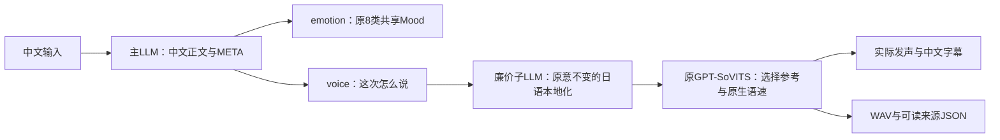

# 表达目标与日记排版：实现说明

2026-10-18。本文解释本轮改动的原理。技术验证结果与入口见 [交付说明](expression_diary_delivery.md)，恢复工作见 [checkpoint](expression_diary_checkpoint.md)。

## 先区分“共享心情”与“怎么说”

角色共享心情仍是原来的8种 CharacterEmotion；它会影响同一个CharacterCore的状态，保存在原数据库中。发声目标属于这次回复的表现方式，例如有些犹豫、平直朗读，可以独立选择。增加表现目标不等于增加人格、关系数值或另一份记忆。



主模型控制头示例：

```text
<META emotion="concern" action="none" voice="hesitant">
老师，我还没有想好要先做哪件事。
```

解析器只识别首行控制头，正文继续中文。voice为可选字段；旧的只有emotion/action的头仍可读，voice默认继承emotion。未知voice回退到合法emotion，不允许任意字符串进入参考选择。hesitant和flat不加入数据库Mood枚举，schema仍为v9；原始头和音频sidecar保留可审计信息。

前两次多轮实测发现，模型可能模仿已经去掉控制头的历史正文，从第三轮起直接省略META，导致普通neutral回退；仅加强系统提示仍未解决。现在PromptBuilder为Companion请求的近期assistant历史重建规范控制头，让实际角色消息也示范一致格式。原文只读前256字符，只有已投影的Companion记录可提供白名单元信息，绝不整段重放原始控制文本；旧版原文/正文相同的消息不猜标签。历史缺元信息时使用neutral/none作为格式缺省，不代表修改过去的心情或事实。

这份规范头仅存在于发给主模型的请求中，和正文一起计入原有12000字符预算；用户字幕、MomoTalk、存储和记忆提取继续使用原中文正文。AgentPet请求仍只带正文。提示同时提醒过去情绪不必沿用，按当前语义重新选择。这提高格式遵循率，不能让概率生成变成绝对保证；当前回复缺头时仍安全回退，不根据用户话语硬猜情绪。

前端分别接收Emotion和VoiceIntent，场景中的Spine仍按已有Emotion适配；发声目标不会强迫不存在的Spine动作。语音场景Session固定其目标，依次传给翻译与TTS。请求取消、单GPU推理门控、中文字幕随实际音频出现的规则继续保留。

## 四种新增预期能做到什么

当前新增的是日语表达目标，未添加权重、依赖或额外本地大模型。

| voice | 本地化目标 | 当前参考 / 语速 | 能力边界 |
|---|---|---|---|
| annoyed | 轻微恼火、措辞克制，不升级冲突 | 交付包原参考 / 1.02 | 无独立怒声录音，只是语气与节奏近似 |
| sad | 低落遗憾，不凭空加哭声 | 交付包原参考 / 0.92 | 无独立悲伤参考，不宣称真实哭腔 |
| hesitant | 保留原文迟疑，不能把肯定改成猜测 | 已认可的害羞参考 / 0.93 | 借用同模型参考的近似，不强制结巴 |
| flat | 减少夸张句尾、克制平叙 | 交付包原参考 / 1.00 | 可以尽量平静，不能保证F0音高曲线完全水平 |

活泼、害羞的原参考与配置保留，普通neutral继续现有自然风格。只有明确的flat目标使用平直配对。中文没有新增独立四组参考，未匹配的目标继续使用原中文默认参考。

为什么不能只写一个emotion参数就得到真正的怒声或哭腔：本机交付的api_v2.py提供参考音频、对应转写、文本与speed_factor等参数，没有一个经过本项目验证的通用强情绪控制按钮。当前模型的韵律受训练和参考影响，换词、换速度不能凭空保证另一种声学情绪。此次跳过新的怒声/哭腔训练，以及保证完全无抑扬的合成。若以后有准确转写的3–10秒对应录音，可以在同一文件接口扩展，不必复制整套模型。

不使用AudioSource.pitch改声音来冒充情绪；原生speed_factor只作小幅节奏调整。一次仍只运行一个模型与一个GPU推理请求。

## 配置怎样被代码读取

[VoiceDelivery.cs](../Assets/App/Core/Audio/VoiceDelivery.cs) 读取资料目录 Config/voice_delivery.json。

```json
{
  "Id": "ja-hesitant",
  "Language": "ja",
  "Emotions": ["hesitant"],
  "ReferenceAudio": "VoiceReferences/ja-shy.wav",
  "PromptText": "与参考音频一致的日语转写",
  "SpeedFactor": 0.93
}
```

这是结构示例，实际文件已有准确的原始转写，不要直接用示例占位文字覆盖。空ReferenceAudio表示使用Runtime/voice-ja.json中的原参考。后端只接受自有VoiceReferences中受限名称的WAV，并核对3–10秒时长。

预设v2会把未改过的旧ja-soft-original中sad/annoyed通用映射拆开，补充新目标；已有自定义映射保留。语速和资料仍由文件决定，重试语音或重启加载。原素材和模型文件不改。

[SpeechLocalizer.cs](../Assets/App/Core/Audio/SpeechLocalizer.cs) 读取 Config/speech_localization.json。v3为恼火、低落、犹豫、平直补充说明，仍只传当前中文短句及voice目标；沿用已有Key、Flash非思考、15秒/384token限制。旧版原始默认说明升级，自定义文本保留。含义优先，禁止为犹豫而把确定事实译成猜测，禁止为伤心编造经历。

音频旁的.speech.json新增VoiceIntent。Emotion保留主模型原8类心情，VoiceIntent表示实际发声目标，ReferenceId/SpeedFactor记录实际选择。旧缓存保持原声音，复听不联网也不重新合成。

## 怎样“教会”LLM分段

[RelationshipDiary.cs](../Assets/App/Core/Memory/RelationshipDiary.cs) 的最终生成提示明确要求：

1. 按共同话题、相处变化和回望感想分段，资料少时允许1–2段，不为凑段而编内容。
2. 返回JSON的paragraphs数组，每项一个自然段，避免让模型把换行挤在单一字符串中。
3. 一般每段约80–160字，默认最长260字。模型不会因段落数被迫产生更多经历。

```json
{
  "paragraphs": [
    "先回顾一段实际聊过的话题。",
    "再写另一段有依据的回望感想。(´▽｀)"
  ]
}
```

服务器将它们用两个换行连接，再提交同一份正文到SQLite与Markdown。旧的diary字符串响应仍兼容。

单靠提示并不保证每次服从。因此 [DiaryTextLayout.cs](../Assets/App/Core/Memory/DiaryTextLayout.cs) 会检查返回值，对超长段优先在完整句子、引号结束处分开；无标点时按长度兜底，并避开UTF-16代理对。它只补空白、规范换行，不润色、不删事实、不生成第二版内容，也不增加一次修复API调用。数据库、前端、MD使用同一份排版结果。

## 颜文字怎样控制疏密

Config/diary_policy.json 的新默认：

```json
{
  "Version": 2,
  "BatchCharacters": 6000,
  "RollingSummaryCharacters": 2400,
  "DiaryCharacters": 4000,
  "MaximumKaomoji": 4,
  "PreferredParagraphCharacters": 160,
  "MaximumParagraphCharacters": 260
}
```

MaximumKaomoji可0–12。0表示不用；默认4是整篇上限，不是每段4个。提示同时给出短篇0–1、中篇1–3、长篇2–4的疏密目标，严肃段落可不用，不连续堆叠、不每段必放。该数量是生成规则，不用机械程序在末尾强塞颜文字。

旧v1策略的“最多1个”默认在下次主动生成时放宽为4；关闭状态0、其他明确自定义上限保留。新叙事版本和策略参与指纹，所以玩家再次生成时会得到按新规则整理的新回顾。启动不会自动重写旧MD；既有文件/玩家批注继续保留。

## 维护与验证

学习时可从DialoguePresentation → CharacterCore → CompanionScreen → CompanionVoicePlayer → SpeechLocalizer/VoiceDelivery逐层阅读。日记从GenerateAsync → DiaryTextLayout → CommitDiaryAsync → SyncExportsAsync阅读。没有新框架或多Agent，也没有让LLM直接改文件。

验证使用随机Validation资料，检查控制头分片、旧头兼容、Mood枚举不变、目标链传递、超长段保字、配置升级和旧自定义保留，再进行真实日语/TTS与日记DB/MD一致性测试。主观情绪相似度最后由玩家试听判断。
